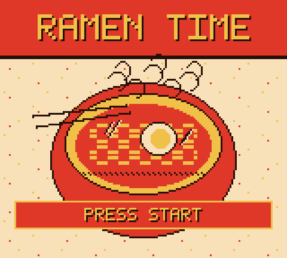
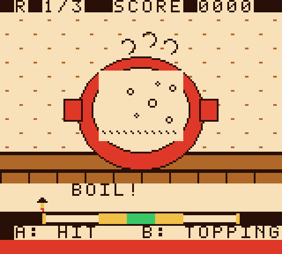
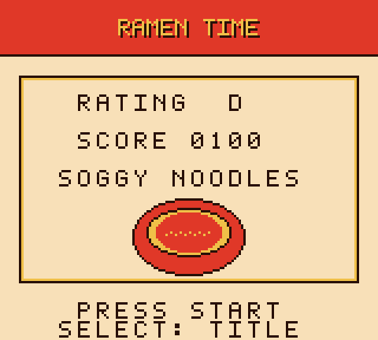

# RAMEN TIME





라면 끓이기 타이밍을 맞추는 Game Boy Color 게임입니다.

[retro-game-creator](https://github.com/dong3789/retro-game-creator) 키트로 만들었습니다. 실제 GBC와 R36S(ArkOS, Gambatte 코어)에서 돌아갑니다.

## 플레이

한 판은 **3라운드**이고, 라운드마다 냄비 하나로 다섯 단계를 갑니다.

**BOIL → NOODLES → SOUP → TOPPING → STOP**

아래 게이지를 지나가는 커서에 맞춰 버튼을 누르면 됩니다.

| 버튼 | 동작 |
| --- | --- |
| **START** | 시작, 또는 결과 화면에서 다시 하기 |
| **SELECT** | 타이틀로 돌아가기 |
| **A** | BOIL / NOODLES / SOUP / STOP에서 타이밍. TOPPING에서는 계란 |
| **B** | TOPPING에서 파 (안 누르면 생략) |

초록 구간은 PERFECT(100점), 그 옆은 GOOD(60점), 빗나가면 0점입니다. 토핑을 타이밍에 맞추면 +20점. STOP을 너무 빨리 누르면 면이 덜 익고(HARD), 너무 늦으면 퍼집니다(SOGGY).

등급은 S 1100점 이상, A 900, B 700, C 500, 그 아래는 D입니다. 만점은 1260점입니다.

## 어떤 고민을 했는지

160×144 화면에서 **버튼 하나로도 타이밍이 바로 읽히게** 하는 게 목표였습니다. 지금 무슨 단계인지, 초록/금색 판정 구간이 어디인지, 냄비 상태가 어떻게 바뀌었는지(물, 면, 국물, 토핑, 익은 정도)를 한눈에 구분하려고 했습니다.

GBC 제한도 같이 봤습니다. 배경·스프라이트 타일은 합쳐 384장, 한 화면에 스프라이트는 40개까지입니다. 그래서 배경은 타일을 재사용(`--dedup`)해서 넣고, 커서는 스프라이트로 움직이게 했습니다.

## 어떻게 구현했는지

게임 로직은 GBDK-2020 C(`src/main.c`)입니다. 그림은 `assets/`에서 그리고 `tools/png2gbc.py`로 타일과 맵을 뽑습니다.

커서는 라운드가 올라갈수록 빨라집니다. 1라운드는 2프레임에 1픽셀, 2라운드는 매 프레임 1픽셀, 3라운드는 매 프레임 2픽셀입니다. 판정 구간은 게이지 112픽셀 중 가운데 16픽셀이 PERFECT입니다. 단계가 바뀔 때마다 냄비 타일만 바꿔서, 물이 끓고 면이 들어가고 국물이 물드는 걸 보여줍니다.

작업은 [retro-game-creator](https://github.com/dong3789/retro-game-creator) 키트의 루프를 따랐습니다. GBDK-2020으로 롬을 빌드한 다음, PyBoy로 헤드리스 플레이테스트를 돌립니다. 스크립트로 버튼을 넣고 `--strict`로 스크린샷 스트립을 뽑아서, 타이틀·플레이·PERFECT·결과 화면을 눈으로 확인하고 고쳤습니다.

## 빌드

GBDK-2020 4.5.0과 Python(pillow, numpy, pyboy)이 필요합니다.

```bash
source ./env.sh          # GBDKDIR=$HOME/gbdk/ , 프로젝트 venv
./build.sh               # -> build/ramen-time.gbc
./build.sh --assets      # 그림 다시 만들고 빌드
./build.sh --playtest    # 빌드 후 PyBoy 스트립
```

## R36S에서 실행

`build/ramen-time.gbc`를 마이크로SD의 `EASYROMS/gbc` 폴더에 넣고, 본문 화면의 Game Boy Color 목록에서 실행하면 됩니다. 코어는 Gambatte를 권장합니다.
